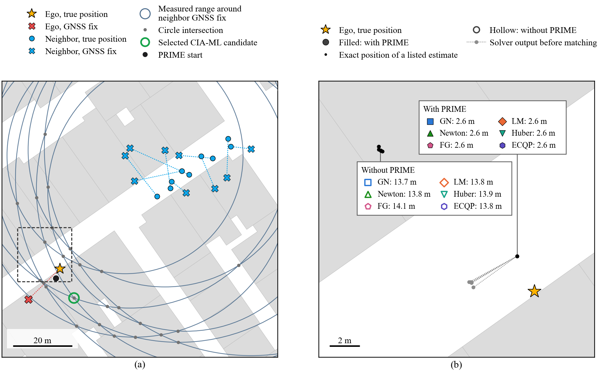
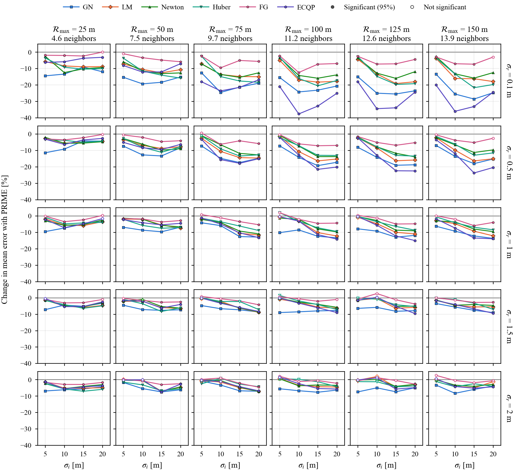
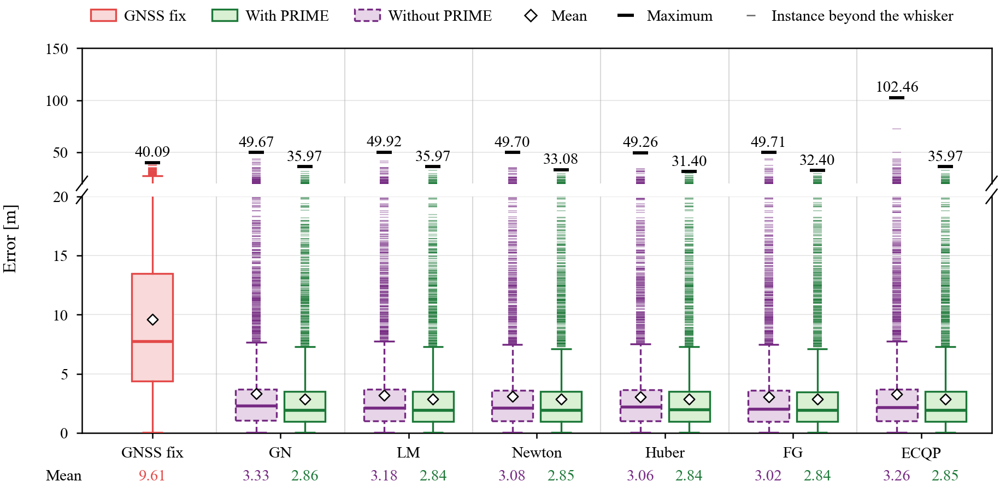
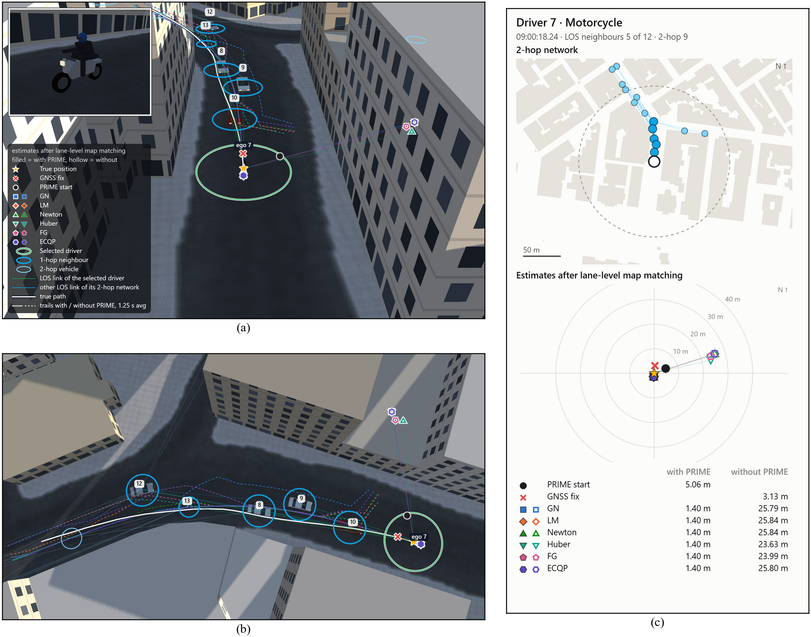

# PRIME: Plug-In Range-Based Initialization for Maximum-Likelihood Estimation in Cooperative Vehicle Localization

**E. Zvi, I. Bilik, M. Segal** · Ben-Gurion University · Under review, *IEEE Transactions on Aerospace and Electronic Systems*

This page presents the method and its main results. The code, data and 3D simulator are kept in a private repository.

## Abstract

Cooperative vehicle localization can refine global navigation satellite system (GNSS) positions using inter-vehicle ranges by iteratively minimizing a non-convex maximum-likelihood (ML) objective starting from the GNSS fixes. When urban GNSS errors are comparable to inter-vehicle distances, this initialization can lead the solver to an incorrect local minimum regardless of its update rule. We demonstrate this limitation for six iterative solvers: Gauss-Newton (GN), Levenberg-Marquardt (LM), Newton, Huber, factor-graph (FG), and equality-constrained quadratic program (ECQP), and propose PRIME, a plug-in initialization that preserves the solver and message protocol. Using data already available to the ego vehicle, PRIME selects the circle-intersection candidate with the lowest ML-derived cost, which accounts for neighbor GNSS errors, and refines it and each one-hop neighbor using damped GN steps. PRIME is evaluated on pNEUMA trajectories with line-of-sight ranging, independent GNSS errors, and equal computational budgets, in 120 radius and noise settings. After lane-level map matching, it reduces the mean error of GN in all settings and of each other solver in 105-117 settings by up to 37.7%, and places more vehicles in their correct lanes in most settings. Before matching, it improves each solver in 114-120 settings. It matches a three-start multi-start at a third of its cost, cuts the iterations of all six solvers by up to 27%, and costs less than half an ECQP iteration. Its benefits persist across two additional segments, at track starts and restarts, and, with smaller magnitude, under undetected non-line-of-sight links and correlated GNSS errors.

## How PRIME Works

Each vehicle, the ego, knows its own GNSS fix, the GNSS fixes broadcast by its line-of-sight neighbors and the ranges it measures to them. PRIME turns this data into a better starting point in three steps.

1. **Intersection generator.** The ego draws a circle with the measured range around the GNSS fix of each neighbor and collects every pairwise circle intersection. These intersections and the ego GNSS fix form the candidate pool.
2. **Candidate selection and refinement.** Each candidate is scored by a cost derived from the ML objective. The cost accounts for the GNSS errors of the neighbors through an errors-in-variables model. The candidate with the lowest cost is refined with damped Gauss-Newton steps.
3. **Neighbor refinement.** Each one-hop neighbor is refined with damped Gauss-Newton steps on the ranges of its links in the two-hop subgraph.

The solver then runs unchanged from the PRIME start. PRIME adds no messages, because every solver already collects the two-hop subgraph.

*PRIME for one vehicle in the pNEUMA dataset (communication radius 100 m, GNSS error 10 m, ranging error 0.5 m). (a) Circle-intersection candidates and the PRIME start. (b) Estimates with and without PRIME after lane-level map matching, in the dashed square of (a).*

## Evaluation

PRIME is tested on real vehicle trajectories from the pNEUMA drone dataset, recorded over the center of Athens. Ranges exist only on line-of-sight links, which are decided by the OpenStreetMap buildings. The grid has 120 settings: a communication radius of 25 to 150 m, a GNSS error of 5 to 20 m and a ranging error of 0.1 to 2 m. Each solver runs with the same computational budget with and without PRIME. All results are reported after lane-level map matching with a hidden Markov model.

*Change in the mean error of the six solvers with PRIME after lane-level map matching in the 120 settings. Negative values are improvements.*

*Error distributions of the GNSS fixes and of the six solvers with and without PRIME after lane-level map matching (communication radius 100 m, GNSS error 10 m, ranging error 0.5 m).*

## 3D Simulator

A WebGL simulator replays the pNEUMA traffic among the buildings of Athens. For any vehicle, it shows the two-hop network, the line-of-sight links and the estimates of the six solvers with and without PRIME. It serves as a tool to evaluate PRIME and the solvers vehicle by vehicle.

*The 3D simulator showing a motorcycle and its estimates after lane-level map matching. (a) Street view and close-up. (b) Top view with paths over the past 6 s. (c) Two-hop network and errors with and without PRIME.*

## Citation

E. Zvi, I. Bilik, M. Segal, "PRIME: Plug-In Range-Based Initialization for Maximum-Likelihood Estimation in Cooperative Vehicle Localization," *IEEE Transactions on Aerospace and Electronic Systems*, under review.

## Contact

[LinkedIn](https://linkedin.com/in/eyal-zvi-a48935220) · eyalzvi11@gmail.com
